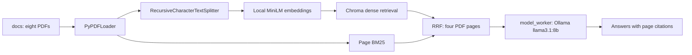

# bls-labor-market-rag

A local retrieval augmented generation experiment using **eight official BLS
PDFs and nine questions**: eight answerable cases and one intentional abstention.
The same `llama3.1:8b` model ran once per question with and without retrieval.
These are development questions, not a held-out benchmark. All results below
come from the fresh corpus; earlier scores were removed and not reused.

## Read the results

- [Editable reflection designed for one page](artifacts/reflection.docx) and [verified one-page PDF with the same content](artifacts/reflection.pdf).
- [Per-question comparison](artifacts/comparison.md), [full comparison CSV](artifacts/comparison.csv), and [raw paired JSONL](artifacts/final_evaluation.jsonl).
- [Verified PDF references](artifacts/source_reference_table.md), [reference CSV](artifacts/source_reference_table.csv), and [quality assessment](artifacts/quality_assessment.md).
- [Page judgments](artifacts/retrieval_judgments.csv), [retrieval metrics and gold reference pages](artifacts/retrieval_metrics.json), and [summary](artifacts/summary.json).

|Measure|Fresh result|
|---|---|
|Corpus|8 unmodified official BLS PDFs; 172 pages; 1178 chunks|
|Paired completion|9/9 cases; 18/18 calls; zero API/runtime errors|
|RAG correctness|12/18 points; 6/9 fully correct|
|No-retrieval correctness|2/18 points; 1/9 fully correct|
|Answerable cases only|RAG 10/16 points, 5/8 fully correct; baseline 0/16, 0/8|
|Macro Precision@4|40.625%; 13 directly relevant pages / 32 returned slots|
|Macro reference-evidence Recall@4|100%; 8/8 documented canonical pages retrieved|
|Evidence sufficiency|8/8 answerable cases|
|RAG citation support|4/7 factual responses; pure abstentions excluded|
|Intentional abstention B9|Both paths declined to invent a Seattle city tax rate|

**Retrieval unit: PDF page. K=4 throughout.** Precision uses manually judged
returned pages; a missing slot would count as nonrelevant. Recall uses the
canonical PDF pages documented in `references.json`. This is **reference-evidence
recall, not exhaustive corpus recall**: other relevant pages may exist. Macro
averages use the eight answerable questions only. B9 is assessed separately;
top-four absence alone is not evidence that an answer is absent from the corpus.

Retrieval found every canonical page, but generation still failed on B1's table,
B2's preliminary footnote, and B3's self-contradictory wage answer. B4's extra
component figures were correct but cited the wrong supporting page. These
failures were preserved rather than fixed through another scored run. Manual
judgments and rationales are in `artifacts/scoring_judgments.json`, bound by hash
to the raw outputs. They are not independent expert ratings or model self-grades.

RAG made three abstentions, including B3's partial abstention; baseline made
eight. Mean generation worker wall times were 5.602s (RAG) and 5.255s (baseline).
RAG additionally averaged 2.165s for retrieval; worker time includes process
startup and is not end-to-end RAG latency. No final correctness case was excluded.

## Project layout

```text
docs/          Eight saved official PDFs and source_inventory.json
provenance/    Official HTML cross-checks, reuse terms, cleanup and question history
artifacts/     Fresh answers, judgments, metrics, references and reflection
evaluation/    Manual scoring and report generation (module commands)
scripts/       Validation, deterministic ZIP packaging and publication helpers
tests/         Offline regression tests; live inference explicitly opt-in
index/         Local Chroma index and chunks, excluded from Git and submission
submission/    Local historical package, ignored; download the release ZIP
```

`rag_eval.py` is the CLI. The frozen runtime files `rag_eval.py`,
`model_worker.py`, `final_evaluation.py`, and `sources.py` remain at root:
their exact bytes are bound into the frozen evaluation. The rubric also stays
at its frozen path. Moving these would require changing historical hash checks.
Run helpers from the repository root with `python -m scripts.<name>` and
scoring/report tools with `python -m evaluation.<name>`.



Loading, chunking, embedding, retrieval and fusion live in `rag_eval.py`;
`model_worker.py` executes generation in a bounded subprocess.
Temporary QA files remain
ignored under `tmp/`; protected old credential helpers remain ignored in
`archive/`. Neither directory is part of the submission. Publication target: public repository `ssilva9912/bls-labor-market-rag`.

## Sources and reuse

The corpus contains BLS releases for 2024 annual state unemployment, December
2024 state employment/unemployment, May2024 occupational wages, Q4-2024 business
employment dynamics, 2024–2034 employment projections, December2024 metro data,
December2024 national employment, and December2024 job openings/turnover.
Washington state and national statistics are labelled separately; projections
are not observed outcomes. Questions specify their release vintage.

`docs/source_inventory.json` records every source/PDF URL, release date,
retrieval timestamp, PDF/HTML hash, attribution and reuse basis. All eight PDFs
were available officially; **none is a generated local snapshot**. References
cite physical, one-based pages of these saved PDFs. The PDFs themselves were
ingested; HTML is provenance and a cross-check, never an embedding input.

[BLS permits reuse of its public-domain material](https://www.bls.gov/opub/copyright-information.htm)
and requests attribution, with exceptions for copyrighted photographs/illustrations
and separately protected emblems. See [third-party notices](THIRD_PARTY_NOTICES.md).
Original PDF branding is retained in official documents, not adopted as project
branding or endorsement. Supporting pages were visually reviewed for tables,
headers, units, dates and footnotes; extracted reference figures were also checked
against captured official HTML. Not every graphical map/chart is reconstructed
as text; evaluation questions use verified extractable pages.

## Run the offline checks

Use **Python 3.12**. Create a virtual environment on a fresh machine. Preserve an existing working environment until a separate fresh installation is verified.

```powershell
py -3.12 -m venv .venv
.\.venv\Scripts\python.exe -m pip install -r requirements.txt
.\.venv\Scripts\python.exe -m pip check
.\.venv\Scripts\python.exe sources.py verify
.\.venv\Scripts\python.exe -m unittest discover -s tests -v
.\.venv\Scripts\python.exe -m scripts.verify_submission --offline
.\.venv\Scripts\python.exe -m scripts.publication_audit --check
```

Offline checks need neither credentials, an Ollama server, nor model downloads.
They verify the eight PDF/source hashes, supporting excerpts, frozen available
inputs, paired settings, manual-score binding, retrieval metric calculations and
publication files. Local index files are explicitly reported as omitted in the
submission; no source PDFs are silently skipped. Tests mock model calls. Live
Ollama/Chroma checks are discovered and reported as skips unless opted in.

`requirements.lock.txt` captures the frozen runtime's direct package versions;
it is not a complete portable transitive lock. Runtime dependencies are in `requirements.txt`; document generation uses `requirements-docs.txt`. Tests use standard-library unittest and the minimal `requirements-test.txt`. CI installs only offline test requirements, including BM25 for the retrieval regression tests. The historical lock snapshot is preserved as evaluation evidence.

## Reproduce local inference

Install Ollama from https://ollama.com/download and start its local service. Ollama must serve `http://127.0.0.1:11434`. This run used the installed
`llama3.1:8b` Q4_K_M, about4.92GB on disk, digest
`46e0c10c039e019119339687c3c1757cc81b9da49709a3b3924863ba87ca666e`.
Generation was frozen at temperature0, seed42, context8192, output1024,
keep_alive10m, HTTP timeout180s, worker deadline240s and one attempt. Both arms
use identical options. The local model fits the development RTX4070 Laptop8GB
GPU; system RAM is63.63GiB. No model downloads or hosted requests were made.

On a fresh machine only, explicitly obtain that model after reviewing its size
and cache `sentence-transformers/all-MiniLM-L6-v2` once. Runtime embedding loading
uses `local_files_only=True`, normalized CPU vectors, chunks1000/overlap180.
The application never pulls models automatically.

```powershell
# Fresh machine only: these two commands download models, never run in CI.
ollama pull llama3.1:8b
.\.venv\Scripts\python.exe -c "from sentence_transformers import SentenceTransformer; SentenceTransformer('sentence-transformers/all-MiniLM-L6-v2')"

# Fresh index: replaces only this project's index/ after successful PDF parsing.
.\.venv\Scripts\python.exe rag_eval.py ingest
.\.venv\Scripts\python.exe final_evaluation.py validate
.\.venv\Scripts\python.exe rag_eval.py ask "What was Washington's annual unemployment rate in 2024?" --retrieval hybrid
```

Hybrid retrieval maps dense chunk matches to PDF pages and combines them with
page-level BM25 using RRF,16 candidates per route, returning up to4 pages with
5000-character limits. An explicitly named release is used as a source facet.
Header/footnote and named-row preservation prevents long tables from losing their
bottom rows. A place-table coverage slot was developed after B1's reference page
was initially missed. `artifacts/retrieval_development.json` and the quality
assessment disclose development use; the final generation ran once after freeze.

The supplied final output refuses overwrite. To reproduce the full paired
experiment, work in a separate copy, preserve the published artifacts elsewhere,
create a new local index and a new freeze for that reproduction, then run
`python final_evaluation.py run`. It must receive new manual judgments against
its own raw-output hash; supplied scores cannot be transferred to changed answers.
Hardware, runtime and model revisions can change outputs despite a fixed seed.

Local opt-in checks use `RUN_LIVE_OLLAMA_TESTS=1` and `RUN_LIVE_RETRIEVAL_TESTS=1`.
Run `python -m unittest discover -s tests -v`; they use installed models only and
do not repeat the frozen final evaluation. `python -m evaluation.score_final` recomputes scores from the existing hash-bound manual judgments, without model calls. Install `requirements-docs.txt` before running `python -m evaluation.report` and `python -m evaluation.report --pdf-only` to regenerate the
editable reflection from current scored results. Native Word automation was blocked by the current session;
the DOCX XML structure was validated and the final PDF was typeset from the same analysis prose and rendered with Windows.Data.Pdf for visual review. Native Word pagination remains
unverified and may vary. Open the DOCX to edit it; edits may
change pagination and should not be represented as the original evaluation.

## CI and publication

[GitHub Actions](.github/workflows/ci.yml) uses Python3.12 and read-only repository
permissions, installs minimal test dependencies, runs offline tests and artifact validation,
and audits publication paths/secret patterns. It has no credentials, Ollama service
or model download step. Dependency installation needs package-repository access.
GitHub Actions is checked against the exact pushed commit during publication.
See [publication review](PUBLICATION_REVIEW.md) and the exact file inventory in
`publication_files.json`. The secret-pattern scan is a heuristic, not a guarantee.
External credentials, environments, caches and indexes remain excluded.

## Submission and validation status

The verified standalone submission is the [release ZIP](https://github.com/ssilva9912/bls-labor-market-rag/releases/tag/submission-v1). The historical `submission/` directory remains local and ignored. The analysis is titled **Evaluating Retrieval-Augmented Generation on BLS Labor Market Reports** and is supplied as `submission/artifacts/reflection.docx` and `submission/artifacts/reflection.pdf`. Comparison and source/reference tables, raw JSONL, CSV results, judgments, and manifests are in its `artifacts/` directory.

The current analysis is [reflection.pdf](artifacts/reflection.pdf), with the
[comparison table](artifacts/comparison.md) and [eight source PDFs](docs/).
[GitHub releases](https://github.com/ssilva9912/bls-labor-market-rag/releases)
contains `submission-v1`, uploaded and downloaded with matching SHA-256
`12fcfcfe673e514316313293f54b9092a7a86210ddd7539b45c38bcb6ab94324`.
The duplicate `submission/` was untracked only after that verification; local
files were preserved. Its older standalone commands remain valid locally.

Build the current complete assignment without touching the local submission:
`python -m scripts.package_submission`. It writes
`tmp/bls-labor-market-rag-submission.zip`, uses sorted entries and fixed metadata,
and verifies PDF provenance, frozen bindings and every archived checksum.
The published release is tied to commit `41cfc5d`, whose matching Actions run passed.
Future builds reflect the current repository; the published ZIP preserves that reviewed version.
Never delete the local submission directory as part of publication.
Captured HTML is required reference data: the unchanged source inventory binds
each snapshot's path and hash, and source validation checks those bytes.
Only those HTML snapshots are marked linguist-vendored; application code remains visible.

The cleanup finishing session verified Python 3.12.10, Git remote access, GitHub authentication, dependency compatibility, all 34 offline tests (two expected live skips), source and frozen artifact validation, and the cached local hybrid retrieval smoke check. The local Ollama service was started and live freeze validation passed. Frozen results and scores were preserved. Native Word pagination remains unverified.

For a separate fresh-install check: `py -3.12 -m venv .venv-fresh`, then run `.\.venv-fresh\Scripts\python.exe -m pip install -r requirements.txt -r requirements-docs.txt`, `-m pip check`, and `-m unittest discover -s tests -v` with that interpreter. After caching the models explicitly, use the documented ingest and ask commands for a live smoke check.

From the project root in the owner's normal PowerShell session, run `./scripts/finish_publish.ps1` to attempt isolated fresh-install validation, run the required offline checks, authenticate securely if needed, publish the reviewed files to the authorized public repository, and wait for its actual Actions result. It stops on unexpected repository content, validation failures, or push errors and never force-pushes. Native Word pagination still needs a separate check before submission.

When fresh installation, pip check, offline validation, and the existing tests have
already passed, run `./scripts/finish_publish.ps1 -ResumePublication`. This reruns the
focused audit tests, verifies the updated submission, and audits publication
files before continuing to commit, push, and verify the matching Actions run.
